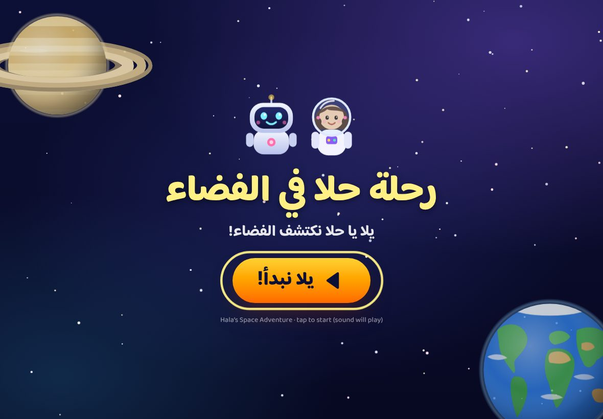
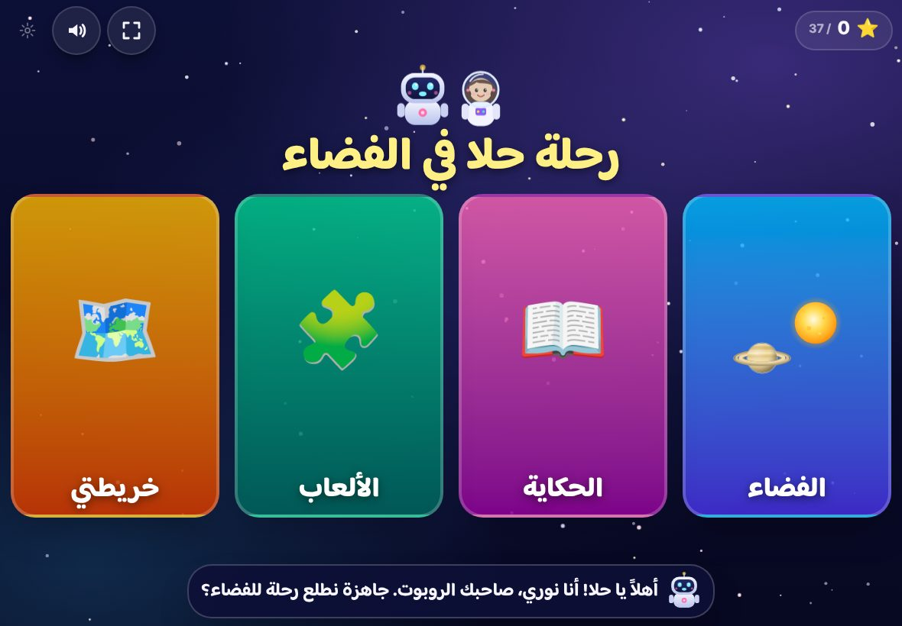
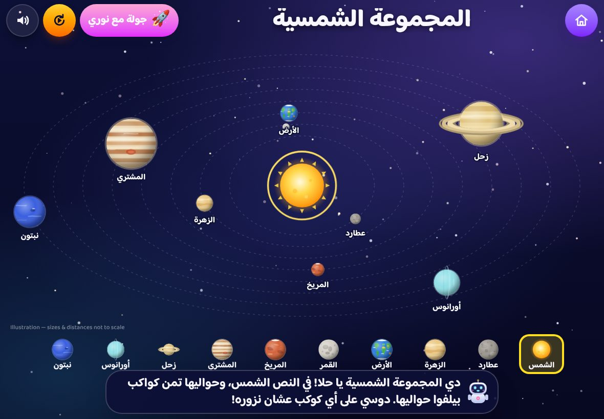
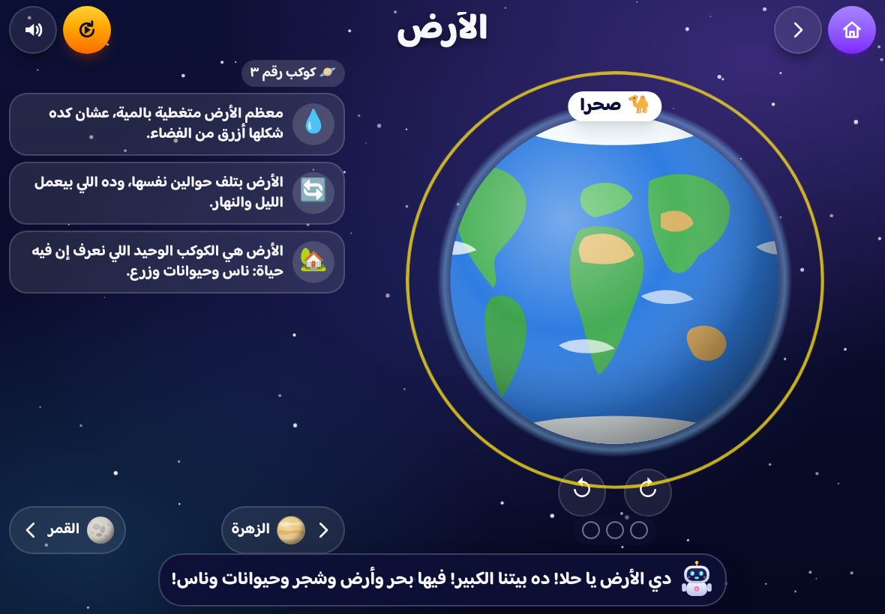
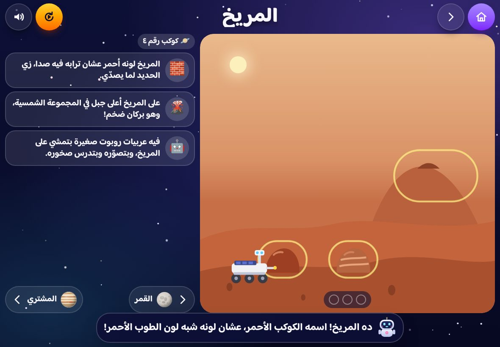
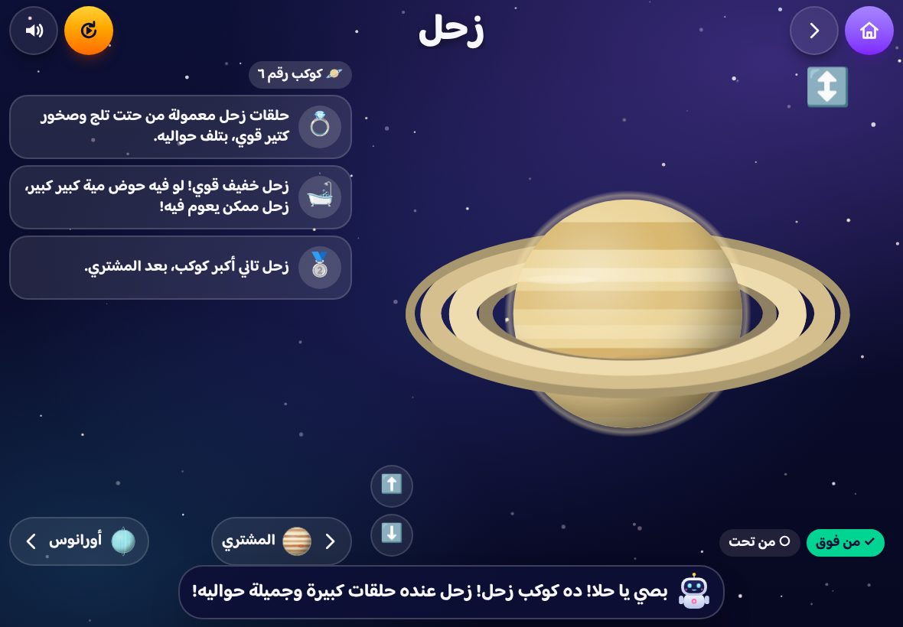
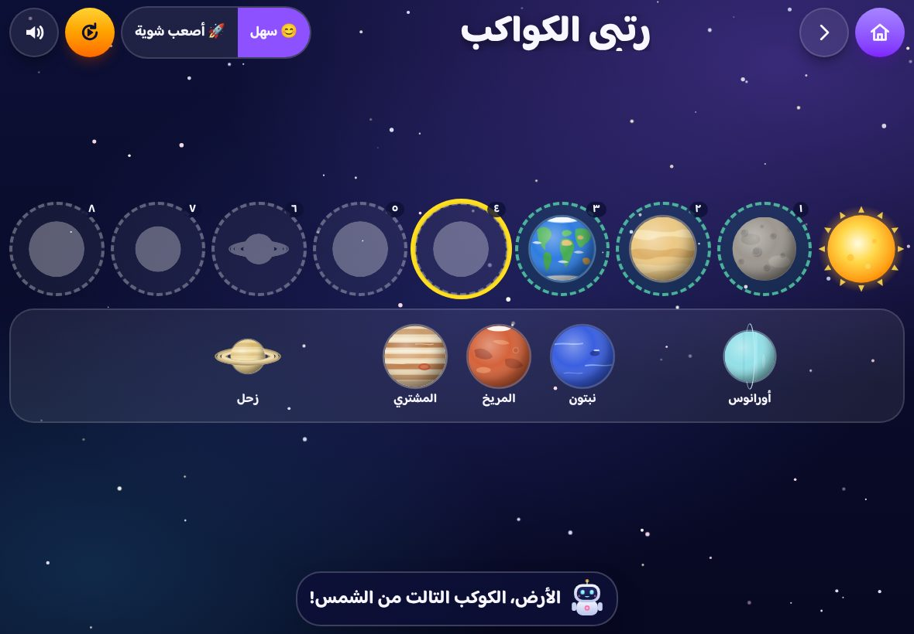
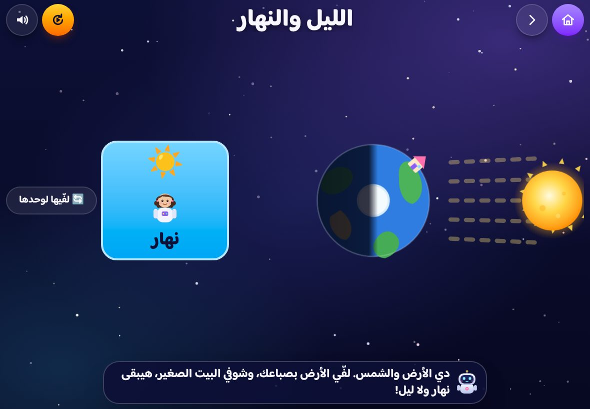
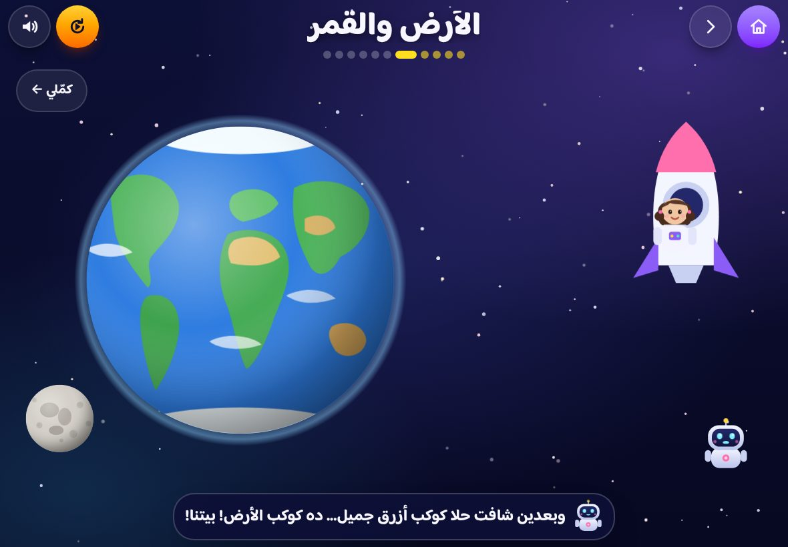

# رحلة حلا في الفضاء · Hala’s Space Adventure

> **يلا يا حلا نكتشف الفضاء!**

An interactive, Arabic-language (friendly Egyptian dialect) solar-system adventure for children aged 3–6, built for **Hala (حلا)**. It works without reading: everything is spoken, shown with pictures, and controlled with big touch targets. It runs entirely in the browser as a static site, with no accounts, ads, analytics, API keys or backend.

**Live:** https://moh-mahgoub.github.io/hala-space-adventure/

| Start | Home | Solar system |
|---|---|---|
|  |  |  |
| **Earth: spin it** | **Mars: drive the rover** | **Saturn: view the rings** |
|  |  |  |
| **Arrange the planets** | **Day & night** | **Story** |
|  |  |  |

---

## Features

### Explore the solar system
- **Animated orbit view**: the Sun, the 8 planets and the Moon orbit gently. Planets stop moving while a finger is on them, so they're easy to tap, and the tap targets are generous. A planet strip at the bottom also lists everything in order from the Sun (right to left, RTL).
- **Guided mode** (default): Nori highlights the next place to visit. A **guided tour** (🚀 جولة مع نوري) goes from the Sun to Neptune with narration.
- **Ten discovery scenes** (Sun, 8 planets, Moon). Each one has a big animated body, its Arabic name, a "star / planet #N / moon" badge, 3 tappable spoken facts, an interactive activity, replay narration, and next/previous navigation (also swipeable).

| Body | Activity |
|---|---|
| الشمس | Tap 3× and the Sun lights up the planets. It's a star (with a safety message: never look at it) |
| عطارد | Find and **count** 5 craters (Arabic counting) |
| الزهرة | Clear the thick clouds to see the hot, volcanic surface |
| الأرض | **Spin Earth with a finger** to find ocean 🐳, land 🌳 and desert 🐪 (with inertia) |
| القمر | Drag the Moon **around Earth**: one orbit ≈ one month |
| المريخ | Tap rocks and the **rover drives** to inspect them (and Olympus Mons) |
| المشتري | Drop Earths into Jupiter. Earth is drawn at the **true size ratio** (≈1:11), and more than 1,000 Earths would fit inside |
| زحل | Drag up/down to view the **rings** from above and below, then tap to zoom in on the ice and rock pieces |
| أورانوس | Tap to make it **roll on its side** |
| نبتون | Tap for the strongest winds. The faraway Sun is just a dot. Mentions Pluto as a *dwarf planet* |

### Games (all replayable, no timers, no penalties)
1. **فين الكوكب؟ (Find the planet)**: "يا حلا، فين كوكب زحل؟" with 3 big choices. A wrong answer gets a gentle hint, and after 2 tries the right planet glows.
2. **رتّبي الكواكب (Arrange the planets)**: forgiving drag-and-drop, or tap a planet then tap its slot. The easy level shows ghost hints and highlights the next slot.
3. **الليل والنهار (Day & night)**: Earth seen from above the North Pole. Turn it and watch the little house go from day to night. It can also spin on its own, counter-clockwise like the real Earth.
4. **رحلة رائد الفضاء (Space explorer)**: tap or hold where the ship should fly (or use the arrow keys). Collect stars and visit planets. The Sun gently stops the ship; there are no hazards.
5. **ضل مين؟ (Whose shadow?)**: match a silhouette to its planet.
6. **مين الأكبر؟ (Which is bigger?)**: pick the bigger planet, then see the *true* relative sizes.

### Story: «حلا ورحلة الكواكب الثمانية»
Eleven short narrated chapters (about 6–8 minutes). Hala and Nori fly from her bedroom past the Sun and all 8 planets and come back home. Along the way there are simple choices (sunglasses or close your eyes?), things to tap (launch the rocket, roll Uranus, blow Neptune's winds), counting the 8 planets, and a good-night ending. Any chapter can be replayed from the chapter menu.

### Rewards (gentle and finite)
- 37 stars, each earned once (visits, activities, games, story chapters), and 6 badges.
- **خريطتي (My map)** shows visited planets in colour and unvisited ones as dim "؟".
- A one-time celebration after discovering all 8 planets.
- No streaks, timers, rankings or loss of progress.

### Nori (نوري), the robot guide
An original SVG character whose mouth moves while it talks. Captions (subtitles) with Nori's face show every spoken line, so the app still works with sound off or when there is no Arabic voice.

### حلا — the captain of her own adventure (personalisation)
In **Parent settings → 👩‍🚀 Astronaut & photo**, a parent can:
- **Upload a photo** (iPad: the Photos picker or the camera), then **crop it**: drag with one finger, pinch with two, or use the zoom slider or arrow keys. A live preview shows the face inside a helmet.
- **Replace**, **re-crop** or **delete** it at any time. Delete takes two taps to confirm.
- **Import a cartoon portrait** made elsewhere (drawn by hand or made in an app you trust). The app does **not** turn photos into cartoons, and no CSS trick can.
- **Choose a look:** 🧑‍🚀 illustrated astronaut (the default, no photo needed) · 📷 real photo in the helmet · 🌟 funny sticker (die-cut outline, antennae, stars) · 🎨 imported cartoon.

Where her character appears: the welcome screen (waving), home (floating), the story (her face in the spaceship window, a wobbly takeoff, waving beside the planets, floating by Saturn's rings, a happy dance at the end), the **Moon** (she lands and plants a flag after the orbit), **Mars** (she drives the rover from a bubble cockpit), **Saturn** (peeking around and floating by the rings), the explorer game (pilot in the cockpit), day & night, game celebrations, and the **explorer badges** on the map.

**Reactions to real actions** (spoken in Egyptian Arabic, with a pose and a speech bubble):

| Action | Reaction |
|---|---|
| Tapping the Sun | «واو يا حلا! الشمس منورة قوي!» (waves) |
| Discovering Saturn's rings (viewed from above and below) | «ياااه! بصي الحلقات دي!» (cheers) |
| A correct answer | «برافو يا حلا! إنتي رائدة فضاء شاطرة!» (cheers; alternates with other praise) |
| Completing a planet mission | happy dance + the mission's line |
| Finishing the Moon orbit | she plants a flag: «كابتن حلا حطت العلم على القمر!» |
| First drive on Mars | «يلا يا حلا، نسوق عربية المريخ!» |
| Visiting all 8 planets / finishing the tour | «مبروك يا كابتن حلا! اكتشفتي المجموعة الشمسية كلها!» (dance) |

**Surprises** are rare on purpose. Each eligible moment has about a 35% chance, there is a 90-second gap between any two surprises, and the same surprise waits even longer before it can repeat. The surprises are an oversized helmet, floating upside down near Saturn ("في الفضاء مفيش فوق ولا تحت"), a friendly alien peeking out to wave, and a face sticker after a mission. Takeoff always wobbles a little. To demo or test them, set `localStorage['hala-space:debug-surprises']` to `'always'` or `'never'`.

#### Privacy
- Photos are stored **only in this browser on this device** (IndexedDB, `hala-space-images`). The rest of the profile (look, crop numbers) is in localStorage.
- **Nothing is uploaded.** The app contains no network-upload code (a unit test enforces this), uses no cloud AI and no face recognition, and has no tracking.
- Uploads are downscaled and re-encoded, which strips metadata such as GPS location.
- A different browser or device won't have the photo. Deleting it in the panel, or clearing the site's data, removes it.
- Photos are never part of the repository or the build. A test checks that the only images in the repo are the app icons, docs screenshots and **synthetic** drawn test images; `.gitignore` also excludes `private/`, `photos/` and `*.personal.*`.
- In private browsing, where IndexedDB may be blocked, the photo works until the tab closes and the panel says so.

### Parent settings (hidden)
Press and **hold the small ⚙︎ on the home screen for 3 seconds**. A quick tap does nothing.
- Child's name (default **حلا**; used in every line and title)
- Narration, captions, sound effects, ambient music, volume, speech speed (with a test button)
- Motion: follow the device / reduce / full
- Guided or free exploration
- Reset progress (asks for confirmation), restore defaults
- The voice actually in use, a not-to-scale note, and privacy info

---

## Technology

| | |
|---|---|
| UI | **React 19 + TypeScript**, **Vite 8**, **Tailwind CSS 4** |
| Graphics | Procedural **SVG + CSS animation**, all self-drawn (no image assets, no copyrighted characters) |
| Speech | **Web Speech API** with ranked Arabic voice selection, plus support for recorded audio files and a captions fallback |
| Sound | **Web Audio API**: synthesized effects and a soft ambient pad (no audio files) |
| Font | Baloo Bhaijaan 2 (OFL), bundled locally via `@fontsource` |
| Storage | `localStorage` only (settings + progress) |
| Offline | Small hand-written service worker plus a web-app manifest (Add to Home Screen gives full-screen on iPad) |
| Tests | **Vitest** + Testing Library, **Playwright** (iPad landscape, iPhone, desktop) |
| Hosting | GitHub Pages via GitHub Actions |

**Why not Three.js?** The scenes are 2D, stylized and touch-driven. SVG gives crisp art at any size, small bundles (~111 KB gzipped JS in total) and smooth performance on older iPads. Real 3D would add weight without adding much for preschoolers.

---

## Getting started

```bash
npm install
npm run dev            # http://localhost:5173/hala-space-adventure/
```

| Command | What it does |
|---|---|
| `npm run dev` | Development server with hot reload |
| `npm run build` | Type-check + production build to `dist/` |
| `npm run preview` | Serve the production build locally |
| `npm test` | Unit and component tests (Vitest) |
| `npm run test:e2e` | Playwright end-to-end tests (needs a prior `npm run build`) |
| `npm run test:all` | Everything |
| `npm run list-lines` | Print every narration line id and its text (for recording) |
| `npm run icons` | Re-render the PNG app icons from `public/icon.svg` |

The site is built for the GitHub Pages path `/hala-space-adventure/`. To host it at a domain root, build with `BASE_PATH=/ npm run build`.

## Deployment (GitHub Pages)

`.github/workflows/deploy.yml` runs on every push to `main`:
1. **build**: `npm ci`, unit tests, production build, upload the Pages artifact
2. **deploy**: publish to GitHub Pages
3. **e2e**: Playwright tests in parallel (they don't block deployment)

One-time setup: **Settings → Pages → Build and deployment → Source: GitHub Actions**.

---

## Project structure

```
src/
  content/        ← ALL child-facing Arabic text lives here
    script.ts       narration: home, planets (intro, facts, activities), games, map
    story.ts        the interactive story chapters
    ui.ts           short on-screen labels
    recordings.ts   list of line ids that have recorded audio
    lines.ts        id → text lookup, {name} filling
  data/planets.ts   real scientific data (sizes, order, distances, orbits)
  audio/
    narrator.ts     one-voice-at-a-time narration engine (recorded → speech → captions)
    voices.ts       best Arabic voice picker
    sfx.ts          Web Audio sound effects + ambient music
  state/            settings, progress, stars/badges (localStorage)
  components/       PlanetArt (procedural SVG planets), Nori, HalaAvatar, TopBar, Caption, ParentGate, SettingsPanel…
    character/      ChildAvatar (face), AstronautCharacter, SpaceshipPilot, AvatarReaction, MissionBadge,
                    PhotoCropEditor, PersonalizePanel, FriendlyAlien
  profile/          child look: profile.ts (central store), imageStore.ts (IndexedDB), crop.ts,
                    reactions.ts (real-action reactions), surprises.ts (rare, cooldown)
  screens/          Start, Home, SolarSystem, Planet, Games, Game, Story, Map
  activities/       one interactive discovery per body
  games/            logic.ts (pure, unit-tested) + ChoiceGame, OrderGame, DayNightGame, ExplorerGame
public/             icons, manifest, service worker, audio/narration/
e2e/                Playwright tests
```

## Editing the Arabic content

All narration is in **`src/content/script.ts`** and **`src/content/story.ts`**. Edit the strings directly:
- `{name}` is replaced with the child's name (default حلا). Please keep the spelling **حلا**.
- Keep sentences short. They are spoken *and* shown as captions.
- Lines address the child with feminine forms (بصي، شاطرة، دوسي…).
- `npm test` checks that every line resolves, that placeholders are valid, and that the name is never spelled هالة.

## Replacing synthesized narration with recorded audio

Browser Arabic voices vary. iPad usually has a Gulf/MSA voice ("Majed"/"Maged"); Edge offers Egyptian neural voices. For a natural Egyptian voice (e.g. a parent's):

1. Run `npm run list-lines` to get every line id and its text.
2. Record each line and save it as `public/audio/narration/<line-id>.mp3`, e.g. `public/audio/narration/planets.earth.intro.mp3`.
3. Add the ids to `RECORDED_LINES` in `src/content/recordings.ts`.

Recordings are used only for lines without dynamic placeholders. Lines that contain `{name}` use the recording only while the name is still حلا. If a file is missing or fails to play, the app falls back to speech, and then to captions.

## Adding a game or a story chapter

- **New game:** add pure logic to `games/logic.ts` (with tests), create `games/MyGame.tsx` using `TopBar`, `say()`, `sfx()` and `earn('game:my')`, add its id to `GAME_IDS` in `state/progress.ts`, add a case in `screens/GameScreen.tsx` and a card in `screens/GamesScreen.tsx`, and put its narration under `script.games`.
- **Quiz-style game:** the simplest way is to extend `ChoiceGame` with a new `kind`.
- **New story chapter:** add an entry to `STORY` in `content/story.ts` using `say`, `tap`, `choice` or `count` steps. The player and the chapter menu pick it up automatically.
- **New planet activity:** create `activities/XActivity.tsx` (`onDone()` when finished) and register it in `activities/index.ts`.

## Accessibility

- Audio instructions for non-readers, with captions mirroring every line.
- Touch targets of 64px or more, forgiving drags, and no hover-dependent actions.
- State is never shown by colour alone (✓ marks, ★ dots, icons + words such as ☀️ نهار / 🌙 ليل).
- Semantic buttons and sliders with Arabic accessible names, and keyboard support (Tab/Enter, arrow keys for the sliders and the spaceship).
- Reduced motion follows the system setting or the parent override, and there are no rapid flashes.

## Scientific notes

- Facts were checked against NASA fact sheets. The app distinguishes star, planet and moon, uses 8 planets, and calls Pluto a dwarf planet.
- **Pictures are not to scale** (sizes, distances and orbital speeds). This is stated in the solar-system view and in parent settings. The Jupiter activity and the "which is bigger?" reveal use **true** size ratios.

## Known limitations

- **Voice quality depends on the device.** Speech synthesis rarely speaks Egyptian dialect; iPad typically reads the Egyptian text with an MSA/Gulf voice. Recorded narration (above) is the real fix.
- If a device has **no Arabic voice**, the app shows captions and stays silent rather than mispronouncing Arabic with an English voice. On iPad: Settings → Accessibility → Spoken Content → Voices → Arabic.
- The scripts use feminine address forms. A different child's name is supported, but masculine forms are not (yet).
- Fullscreen: iPhone Safari has no Fullscreen API. Use "Add to Home Screen" instead.
- Offline support kicks in after the first full online visit.
- **The personalisation photo is per browser.** It does not sync between devices, and iPadOS may evict site data from a Safari tab that goes unused for a long time. "Add to Home Screen" makes that much less likely.
- HEIC photos: iPad/iPhone Safari converts them when uploading. Some desktop browsers can't decode HEIC, so the panel asks for JPG or PNG instead.
- Cartoon portraits must be created outside the app.

## Ideas for the future

- Record a full Egyptian-Arabic narration set (with a parent's voice).
- A masculine/feminine address option for other children.
- More bodies: Pluto and the dwarf planets, comets, the asteroid belt, Jupiter's and Saturn's moons.
- Moon phases, seasons, and a "how big is the Sun?" activity.
- A printable "space explorer" certificate.

---

Made with love for حلا 💜 · Font: Baloo Bhaijaan 2 (SIL Open Font License)
